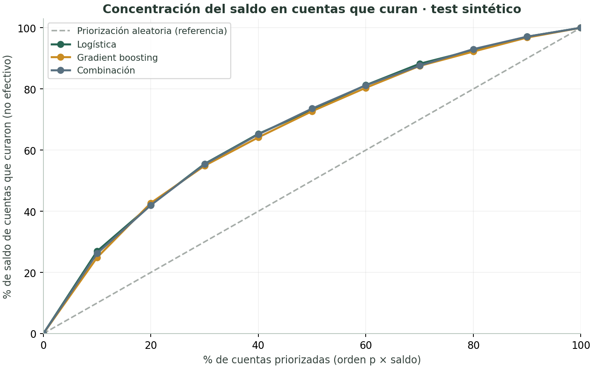

# Quórum Risk. Priorizar cartera en mora

Nota: los datos son sintéticos, generados por un script de este mismo repo. No provienen de ningún cliente, banco ni proveedor, y las cifras no representan desempeño en una cartera real ni resultados comerciales de Quórum Risk.

## De qué trata

¿Por dónde empezar cuando tienes cuentas atrasadas y no puedes gestionarlas todas al mismo tiempo? De eso trata el caso. Entre cuentas que ya traen 30 o 60 días de atraso, la pregunta es cuáles van a volver a ponerse al día en los próximos tres meses. Lo que el caso expone no es tanto el modelo sino el trabajo previo: cómo se define el evento, cómo se congela la información disponible al momento de decidir, y cómo se evalúa en una cosecha posterior.

## Qué terminó recomendando el ejercicio, y por qué no es ML

La conclusión es incómoda a propósito. Ordenando la cartera por saldo y revisando el 20 por ciento de cuentas más grandes, se captura el 41,09 por ciento de la exposición que después cura. El mejor modelo, un gradient boosting, llega a 41,43 por ciento con el mismo criterio. Son 0,34 puntos de diferencia. No hay estimación de incertidumbre de ese margen, no mide pesos cobrados y no prueba que gestionar esas cuentas cambie el desenlace. Con esa evidencia no se justifica el costo ni la complejidad de un modelo en producción. La regla simple es la decisión prudente.

Esa es la postura del caso. Un portafolio serio no es el que siempre vende un modelo, sino el que reconoce cuándo no vale la pena. De ahí el nombre: cada enfoque tiene que ganarse la entrada contra una regla operativa que cualquiera puede verificar, y si no aporta valor claro, no entra. Lo relevante no es el AUC, es cómo se toma esa decisión con un target bien definido, con control de fuga temporal y con pruebas que se pueden correr.

Evidencia: [métricas](reports/metricas.json), [comparación contra reglas](reports/figures/valor_incremental.png), [interpretación y límites](reports/resumen.md).

## El problema de negocio

Entre cuentas que ya están en 30 o 60 días de mora, la idea es priorizar a las que probablemente curen en tres meses. Un score sirve para organizar una cola de análisis o de gestión, pero su valor depende de tres cosas que se deciden antes de entrenar: definir bien el evento, congelar la información disponible al decidir, y evaluar en una cosecha posterior a la del entrenamiento. Nada de esto prueba que llamar más clientes produzca más curaciones.

## Resultado reproducible

El pipeline genera tres candidatos: una regresión logística, un gradient boosting y una combinación ponderada. El peso de la combinación se escoge solo con la validación de 2021, y el test de 2022 no participa en esa decisión. Si el modelo sencillo le gana a la combinación, queda reportado sin maquillaje.

La información se corta en el cierre mensual en que la cuenta está en 30 o 60 DPD. El horizonte de observación son los tres meses siguientes. El entrenamiento usa las cosechas 2019 y 2020, la calibración usa 2021 y la prueba usa 2022. La variable de negocio es el saldo de las cuentas que después curan.

Vale una aclaración de interpretación: la curva de valor recuperable usa el saldo vigente en el momento de decidir, de créditos que después curaron. No mide pesos cobrados, ni ganancia incremental, ni costos de gestión, ni la probabilidad de recuperar el total de la exposición. El ranking ordena por probabilidad de curación multiplicada por el saldo, y es ilustrativo.

Resultados de la semilla pública:

- [Resumen técnico](reports/resumen.md)
- [Métricas por modelo](reports/metricas.json)
- [Lift por decil](reports/tabla_lift.csv)
- [Comparación contra reglas sin ML](reports/figures/valor_incremental.png)



También: [ROC y precisión-recall](reports/figures/discriminacion.png), [calibración](reports/figures/calibracion.png), [lift](reports/figures/lift.png).

## Reproducir desde cero

El entorno de referencia es Python 3.12.14 con las versiones exactas que quedan en `requirements.txt`. En `docs/ENTORNO.md` está el sistema probado, las versiones y qué significa el commit fuente. Instalando ese entorno congelado, los resultados reproducen bit a bit: en una copia limpia con entorno virtual aislado se obtuvieron hashes SHA-256 idénticos para `metricas.json`, `tabla_lift.csv`, `resumen.md` y las cinco figuras. Esa garantía no se extiende a otros sistemas operativos o motores gráficos sin volver a comprobarla.

Desde la raíz del repo:

```bash
python -m venv .venv
# Linux/macOS: source .venv/bin/activate
# Windows: .venv\Scripts\activate
python -m pip install -r requirements.txt
python run_demo.py
python -m unittest discover -s tests -v
```

`run_demo.py` crea `data/` solo y escribe ahí `panel_sintetico.csv` y `decisiones_sinteticas.csv` para inspección local. `data/` está en el gitignore y no se publica ningún dato crudo. Lo versionado en `reports/` son agregados, figuras y resúmenes de la simulación.

La semilla es 20261116, con 2.600 créditos originados el 1 de enero de cada cosecha de 2019 a 2022, y 12 cierres mensuales por préstamo. Cambiar la semilla o el tamaño cambia los resultados:

```bash
python run_demo.py --semilla 20261116 --prestamos-por-cosecha 2600
```

## Cómo está organizado

El universo y el target se definen en `docs/DEFINICION_TARGET.md`. El panel sintético y sus reglas están en `src/data/generador.py`, y la preparación de una foto por cuenta con horizonte completo en `src/data/preparacion.py`. Las variables y su razón de negocio están en `docs/FEATURE_ENGINEERING.md`, y el esquema de validación en `docs/VALIDACION.md`. Cada modelo vive en `src/models/` con su código, sus hiperparámetros y su explicación. La evaluación (calibración, discriminación y concentración de saldos) está en `src/evaluacion/`, y las pruebas de invariancia temporal y reproducibilidad en `tests/`.

### Cómo funciona el generador

El generador lleva contabilidad de mora de verdad, no saltos de estado inventados:

1. Los préstamos nacen en enero de 2019, 2020, 2021 o 2022. Sus atributos iniciales (ingreso, DTI, grado, propósito, saldo, plazo y tasa) salen de distribuciones documentadas en el código.
2. En cada cierre se fija la cuota contractual y se lleva el libro de vencidos: lo exigible es el atraso anterior más la cuota del mes, y el atraso al cierre es el máximo entre cero y eso menos lo que pagó el cliente. Se guardan cuota, pago, vencido inicial, exigible y vencido de cierre.
3. El DPD no se sortea. Sale de las cuotas vencidas equivalentes al cierre, en tramos de 30 días (0, 30, 60, 90, 120). Una cuenta solo cura cuando cubre atraso previo y cuota actual. Si paga menos que la cuota se puede deteriorar; si paga al menos la cuota, su atraso no sube. El 120 no es absorbente.
4. El azar vive solo en cuánto paga cada cliente. La probabilidad y el monto del pago dependen del grado, la carga de la cuota, una capacidad latente, un shock mensual y el vencido acumulado; a 2022 se le añadió una tensión ambiental ficticia. El principal y los intereses se actualizan con una regla simplificada, no con un motor contable real, y los buckets de DPD son equivalentes de cuotas impagas, no la antigüedad exacta de la factura más vieja de un sistema de servicing.
5. El ruido evita que la curación sea perfectamente predecible. No se fabrican etiquetas aparte: el target sale de leer los estados futuros reales dentro de la misma simulación.
6. Es un mecanismo inventado para enseñar el pipeline, no calibrado con estadísticas de ninguna institución. No sirve para estimar la mora o la curación de una población real.

### Anti-fuga: qué entra y qué no

El modelo puede ver las características del contrato en originación, el saldo al cierre del mes de decisión, el vencido de ese mes, el DPD de ese mes, el pago observado hasta ahí, las tasas y ratios, y las recencias y tendencias calculadas con hasta seis meses previos.

Quedan fuera de la matriz el identificador, la cosecha, la fecha de decisión, la etiqueta, el saldo curado observado, cualquier mora, pago o saldo de los tres meses futuros, y los shocks y la resiliencia latente del generador. El historial futuro solo se usa para etiquetar y evaluar, nunca para construir variables.

El esquema lo garantiza una lista positiva de columnas. Hay un test que altera a propósito los estados futuros y comprueba que las variables no se muevan. Y una decisión exige tres cierres anteriores consecutivos observados y tres posteriores con DPD conocido; si falta alguno o viene en NaN, la observación queda no etiquetable y se excluye, nunca se rellena como negativa.

### ¿Le gana a una regla simple?

Antes de justificar un score, el caso compara contra dos políticas sin ML. La primera atiende primero los créditos de mayor saldo al cierre. La segunda atiende primero las cuentas en 30 DPD, después las de 60, desempatando por saldo; es ilustrativa, no una política validada en un negocio real.

La métrica común es el porcentaje de exposición en cuentas que curaron que se concentra al priorizar el 20 por ciento de la cartera. En el informe cada modelo se contrasta contra la mejor de esas dos reglas, en puntos porcentuales. Una diferencia observada no es causalidad, ni cobro realizado, ni beneficio económico. [Ver la medición regenerada](reports/resumen.md).

## Alcance y fuentes

No se usó LendingClub, Freddie Mac, Fannie Mae ni ninguna base con restricciones comerciales. Los datos nacen del generador de este proyecto, así que no hay descarga, redistribución ni transformación de información de terceros. El trabajo es demostrativo y el código es propio.

En un encargo real el target se acuerda con Cobranza y Riesgo, se auditan la calidad y los tiempos de disponibilidad de los datos, se revisan sesgos y regulación, se monitorea estabilidad y calibración, y los datos del cliente no se comparten ni se publican.

Contacto: contacto@quorumrisk.co, quorumrisk.co
